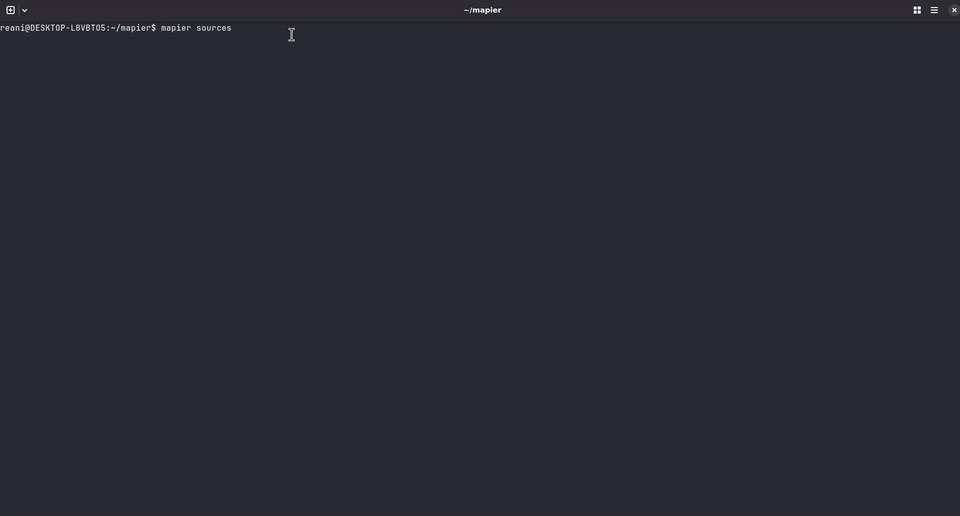
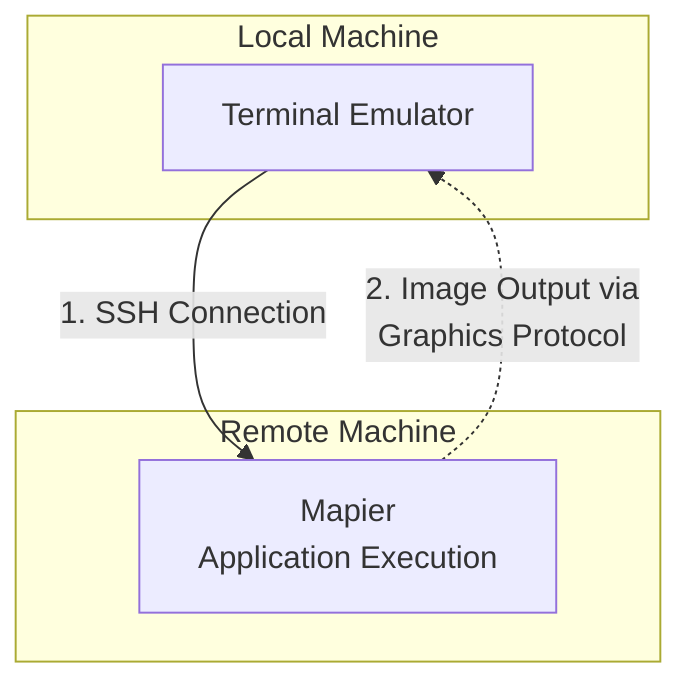

# About Mapier

Mapier is a terminal viewer for geospatial data. Open local layers,
remote files, and WFS services directly from the command line, display them and save them if you like to. Designed to solve the very specific issue when you are in a SSH session or headless machine and have no way of inspecting spatial data whatsoever (or if you just wanna inspect it beforehand without opening a GIS tool or python script): 




> Mapier is in active release preparation. Feedback and bug reports are welcome.

## General Workflow


Note that SSH connecting can be completely skipped if user wants to quick inspect and/or download data locally .

## Requirements

- Debian based Linux distro
- A terminal with [Kitty graphics protocol](https://sw.kovidgoyal.net/kitty/graphics-protocol/)
  support. Mapier has been tested with:
  - [Kitty](https://sw.kovidgoyal.net/kitty/)
  - [Ghostty](https://ghostty.org/docs/features), which supports the Kitty
    graphics protocol
  - [Rio](https://rioterm.com/), which
    supports the Kitty graphics protocol
    
## Windows Requirements

For users accessing a remote Linux machine from Windows, [Rio](https://rioterm.com/docs/install/windows) is the recommended terminal emulator as it has a native Windows version.

**Windows Rio troubleshooting**

Some users may experience image rendering issues with Rio on Windows due to missing files required by the newer Windows ConPTY implementation.

To solve this:

1. Download the [Microsoft.Windows.Console.ConPTY package](https://www.nuget.org/api/v2/package/Microsoft.Windows.Console.ConPTY/1.25.260930003).
2. Extract the downloaded `.nupkg` file. This is a ZIP archive, so you can rename it to `.zip` if necessary.
3. From the extracted package, copy the following files into `C:\Program Files\Rio\` (or your Rio installation directory):
   - `runtimes\win-x64\native\conpty.dll`
   - `build\native\runtimes\x64\OpenConsole.exe`

Restart Rio after copying the files.

## Install

<!-- latest-release:start -->
The latest release is [v0.1.4](https://github.com/victor-arantes/mapier/releases/tag/v0.1.4).

Download and install the latest package:

```bash
wget https://github.com/victor-arantes/mapier/releases/latest/download/mapier_latest_all.deb
sudo apt install ./mapier_latest_all.deb
```
<!-- latest-release:end -->

APT installs the package and its declared dependencies.

## Quick start

Open a local geospatial file:

```bash
mapier states.gpkg
```

Open a remote layer:

```bash
mapier https://example.org/layers/regions.geojson
```

Open several sources at once:

```bash
mapier roads.gpkg boundaries.geojson
```

## Source lists

Pass a plain-text file to load every non-empty line as a source. A source can
be a local path, a URL, or a WFS service URL.

```text
./data/states.gpkg
https://example.org/layers/regions.geojson
https://example.org/geoserver/wfs
```

Run it with:

```bash
mapier sources.txt
```

## WFS layers

When Mapier receives a WFS URL, it lists the available layers and prompts you
to select the layers to view. Enter comma-separated layer numbers, or `N` to
skip them.

## Saving downloaded layers

Remote layers are loaded temporarily. After rendering, Mapier asks whether to
save them. You can select one or more layers and choose one of these formats:

- Shapefile (`.shp`)
- GeoPackage (`.gpkg`)
- GeoJSON (`.geojson`)
- GeoParquet (`.parquet`)

Saved files are written to your system Downloads directory.

## Export configuration

Use the interactive configuration menu:

```bash
mapier --config
```

The configuration is saved in:

```text
~/.config/mapier/config.toml
```

Available export-processing settings:

- **Output CRS** — preserve the source CRS or reproject before saving. Enter
  an EPSG code such as `4674` or `EPSG:4674`.
- **Repair invalid geometry** — apply `make_valid()` before writing.
- **Drop Z coordinates** — export two-dimensional geometries.

Mapier applies enabled transformations only to exported copies; the displayed
and source data are not modified.

## Sample Datasets

The following publicly available geospatial datasets and services can be used to test Mapier.

### Vector Datasets

| Dataset | Provider | Download |
|---|---|---|
| Brazilian Regions (2025) | IBGE | [Download ZIP](https://geoftp.ibge.gov.br/organizacao_do_territorio/malhas_territoriais/malhas_municipais/municipio_2025/Brasil/BR_Regioes_2025.zip) |
| Brazilian Biomes and Coastal-Marine System (2025) | IBGE | [Download ZIP](https://geoftp.ibge.gov.br/informacoes_ambientais/estudos_ambientais/biomas/vetores/2025_Biomas-e-Sistema-Costeiro-Marinho-do-Brasil-1-250000_shp.zip) |
| Brazilian Forest Service Geospatial Data | SFB | [Download Dataset](https://mapas.florestal.gov.br/portal/sharing/rest/content/items/0f0e8cecbc1e4cdd9d94f6ef1e0a5ae4/data) |
| Environmental Embargoes | IBAMA | [Download ZIP](https://ftp-pamgia.ibama.gov.br/dados/adm_embargos_ibama_a.zip) |

### WFS Services

| Service | Provider | Endpoint |
|---|---|---|
| ICMBio Geospatial Services | ICMBio / INDE | [WFS Endpoint](https://geoservicos.inde.gov.br/geoserver/ICMBio/wfs) |

### Multiple datasets text file

Download the text file containing the above mentioned datasets for testing (-> mapier datasets file) 

[Multiple datasets file](sources)


## Build from source

Install Python dependencies for development:

```bash
python3 -m pip install -r requirements.txt
```

Build the Debian package:

```bash
./build.sh
```

The build script checks the package files, prompts before building, and places
the resulting `.deb`, `.changes`, and `.buildinfo` files in `debs/`.


## License

Mapier is licensed under the Apache License 2.0.
